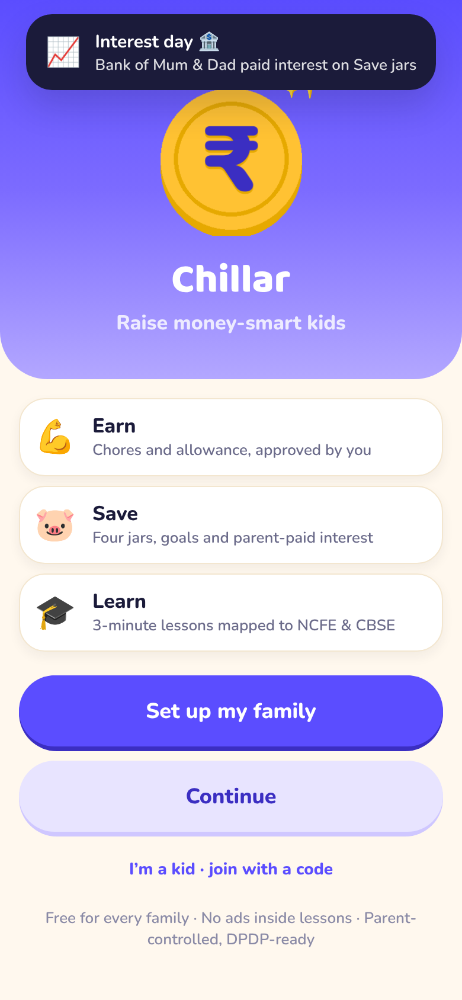
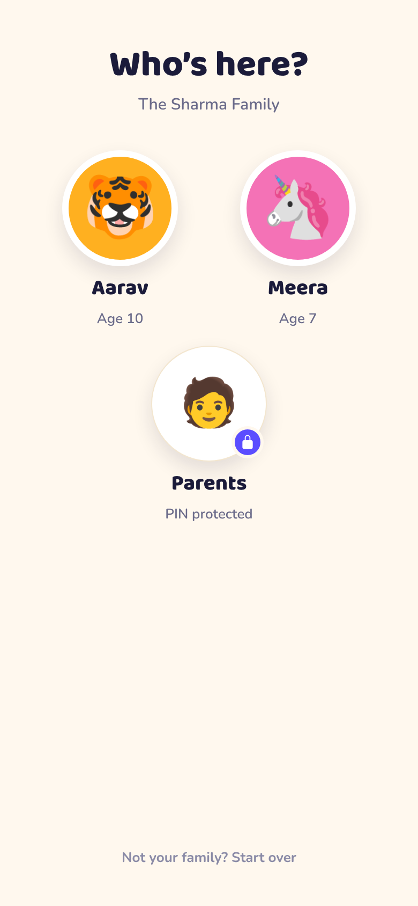
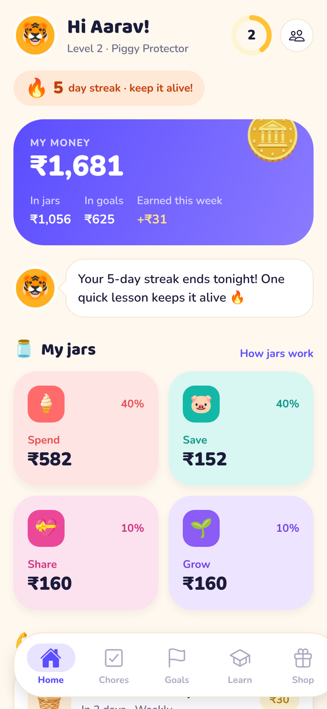
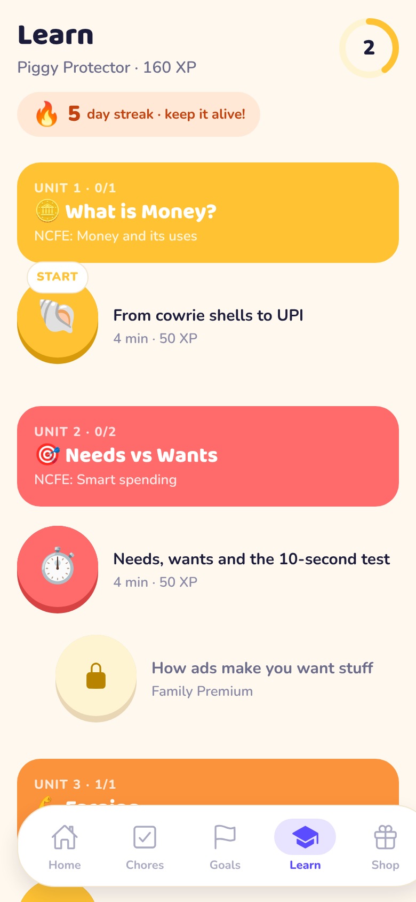
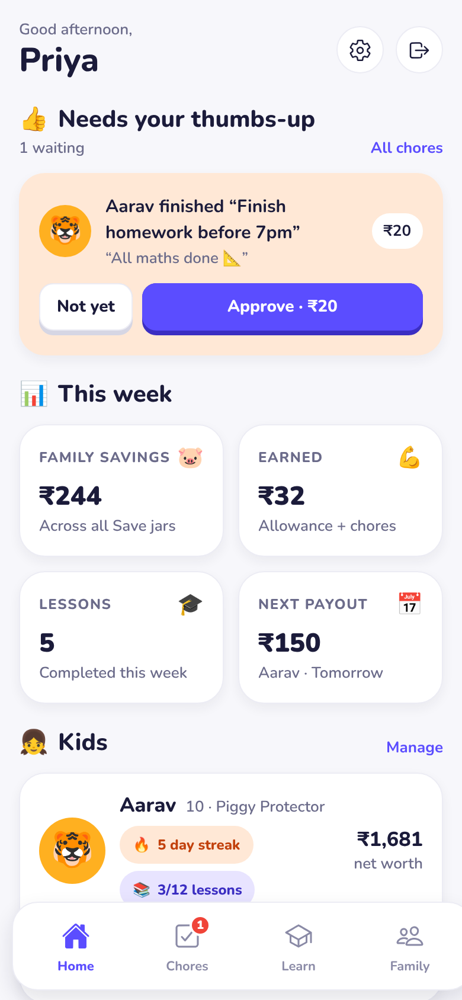
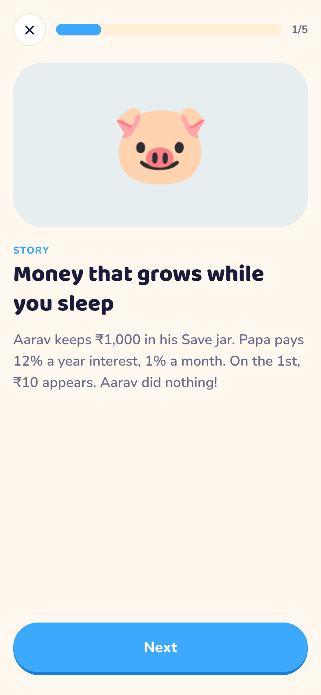
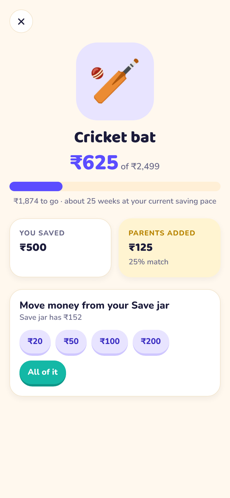
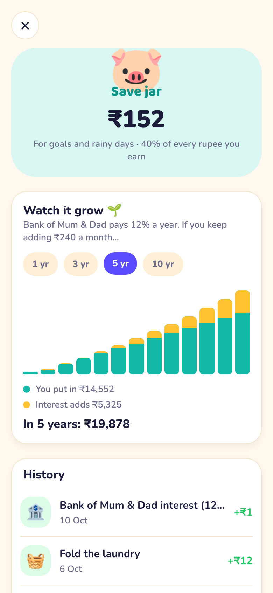
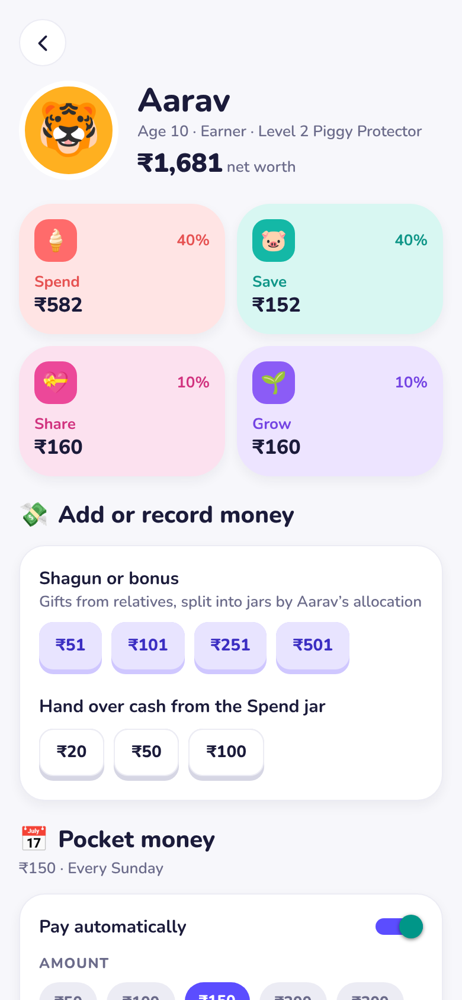
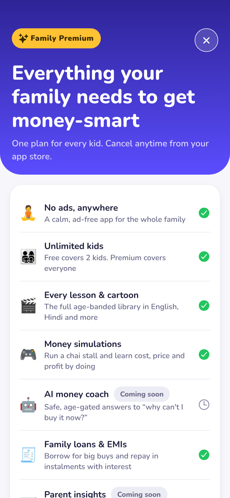

# Chillar — a family money & learning app for Indian kids

> **Working name.** "Chillar" (Hindi for loose change) is a placeholder brand pending a trademark search. Rename in one place: `apps/mobile/app.config.ts`.

Chillar turns the market research in *Kids FinLit + Parenting App (India)* into a product: **one brand, two experiences on one shared core**.

| | Kid experience | Parent experience |
|---|---|---|
| **Who** | Explorers 5–8 · Earners 9–12 · Builders 13–17 | The account holder (DPDP data principal) |
| **Core loop** | Earn (chores, allowance) → split into **Spend · Save · Share · Grow** jars → save for goals → learn why | Post chores, approve work, set allowance & interest, match goals, read guides |
| **Look** | Cream background, Baloo 2 headlines, chunky 3D buttons, mascot avatars, streaks, confetti | Calm indigo-on-grey dashboard, Nunito, stat tiles, approval queue |
| **Ads** | Contextual only, no ad IDs, none inside lessons for under-9s | Consented; personalised only if the parent opts in; **none on Premium** |
| **Offers** | Never shown to kids ("ask a parent") | Family Premium paywall, partner offers |

<p align="center">
  
  
  
  
  
</p>
<p align="center">
  
  
  
  
  
</p>

## What's in the box

```
FinLit/
├── apps/mobile/            Expo SDK 57 app (iOS · Android · web), Expo Router, TypeScript
│   ├── app.config.ts       APP_VARIANT=family|parent|kid → three distributable builds
│   └── src/
│       ├── app/            routes: welcome → onboarding → who → /kid/* and /parent/* (PIN-gated)
│       ├── design/         tokens, kid & parent themes, fonts
│       ├── components/     ui (Button, Card, ProgressRing…), kid, parent, monetization, navigation
│       ├── store/          zustand + AsyncStorage persistence, session (PIN unlock), billing, toasts
│       └── hooks/, lib/
├── packages/core/          Pure-TypeScript domain + 47 unit tests (vitest). No React.
│   └── src/
│       ├── money, ledger, chores, goals, interest, allowance, lessons, streaks
│       ├── entitlements, billing (RevenueCat-shaped), ads policy, consent (DPDP)
│       ├── state, commands (every rule in one place), selectors, seed (demo family)
│       └── content/        29 lessons across 9 NCFE/CBSE-mapped units, parent guides, rewards
├── supabase/migrations/    Postgres schema, RLS and RPCs for family sync (env-gated, not yet provisioned)
├── .github/workflows/      CI: tests · typecheck · lint · web build · Playwright e2e
└── docs/                   architecture, monetization, design, backend, privacy, roadmap
```

## Run it

```bash
npm install                 # workspaces: apps/mobile + packages/core
npm test                    # core unit tests
npm run typecheck           # both workspaces
npm run lint                # expo lint (React Compiler rules on)

npm run mobile              # Expo dev server → press i / a / w
npm run mobile:web          # web preview in the browser

npm run export:web -w apps/mobile && npm run e2e -w apps/mobile   # Playwright smoke test over the web build
```

First launch shows the welcome screen. Tap **Try the demo family** to load the Sharmas from Pune (Aarav 10, Meera 7, parent PIN `1234`), or set up your own family.

Build variants (see `docs/architecture.md`):

```bash
APP_VARIANT=parent npx expo run:ios     # Chillar for Parents  (app.chillar.parent)
APP_VARIANT=kid    npx expo run:android # Chillar Kids         (app.chillar.kid)
```

## How it makes money

Free core for every family, plus five streams modelled in the research (₹160 per active family a year by year 5):

1. **Family Premium** — ₹999/year (7-day trial) or ₹99/month. Ad-free, unlimited kids, full lesson library, simulations, AI coach, family loans, insights, premium rewards. Paywall lives at `/parent/premium`; entitlements and gating in `packages/core/src/entitlements.ts`.
2. **Bank & fund partners** — opted-in offers on parent screens only (`AdSlot audience="parent"`), kids' accounts and SIPs.
3. **Rewards marketplace** — partner rewards earn a commission; parent-fulfilled rewards keep the loop alive for free (`/kid/shop`).
4. **Ads** — contextual on kid screens, consented on parent screens, removed by Premium (`packages/core/src/ads.ts` encodes the DPDP rules).
5. **CSR school programmes & school premium** — the school connector is a V2 module; the consent scope `school_link` is already modelled.

Details and the pricing rationale: `docs/monetization.md`.

## Status: MVP

The full kid and parent loops work end-to-end on device state, verified by an automated smoke test in CI:

- Chores with **photo proof** (camera/gallery), approval queue with the photo, pay-out into jars
- Goals with parent match, Bank of Mum & Dad interest, compounding chart
- 29 lessons across 9 units for all three age bands, streaks, XP, levels
- Family Premium paywall with a mock billing provider; ad policy enforced (contextual-only for kids, none on Premium)
- Parental controls: PIN gate, **enforced daily kid-mode time limit** with parent override, DPDP consent record, **JSON data export**, delete-all
- **Local reminders** (allowance day, streak nudge, pending approvals)
- Cloud sync and kid-device pairing are implemented and env-gated; see `docs/backend.md` to provision

Next (see `docs/roadmap.md`): provision the backend, RevenueCat/store products, DigiLocker consent, Hindi content, school ERP connector.

## License

MIT — see `LICENSE`.
